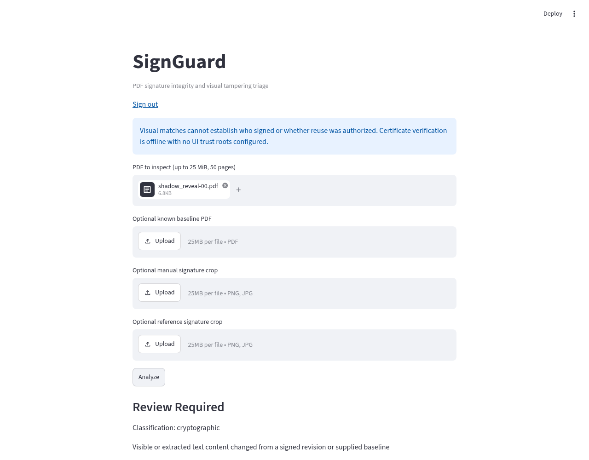

# SignGuard private demonstration

## What has actually run

The cloud browser suite signs into a credential-protected app, uploads synthetic documents, calls
an authenticated private controller, crosses the restricted Unix RPC boundary, launches disposable
Docker PDF workers, renders returned evidence, and downloads JSON/PDF reports. Screenshot and report
artifacts are generated by Chromium, not mockups. No forensic parsing/rendering occurs in the UI.

The Codex Cloud run uses a non-root Streamlit process, a controller container and Docker workers;
its limited VFS disk prevented keeping a running UI container alongside the other tiers. The GitHub
Actions browser job uses containers for all three tiers and records its actual run result separately.
The browser URL is a real cloud **loopback test URL**, not a user-accessible hosted preview.

## See the demonstration remotely now

Open this feature branch's **Private staging integration** workflow in GitHub Actions. A completed
run retains `authenticated-browser-evidence`: screenshots, downloaded reports, JUnit, audit events,
fixture PDFs and route scope metadata. The repository also includes example evidence in
`evaluation/phase4/`. This is an artifact demonstration, not a live hosted service.

## Private live preview status

No private live URL has been issued. The current Codex environment blocks CONNECT to
`api.github.com`, has no verified Codespaces/hosting identity binding, and exposes no supported
private port-forwarding capability. Repository connector access does not grant Codespaces access.
No paid environment was provisioned and no development endpoint was opened to the Internet.

A browser-authorized existing private Codespace or staging host is required. The `.devcontainer`
configuration prepares Python and Docker-in-Docker but forwards no ports automatically. Do not
interpret it as a verified Codespaces deployment: this task could not create/attach a Codespace.

For a browser-only next step, the owner may open GitHub's Codespaces creation wizard for this branch,
using an existing/free-quota environment only, and attach that environment to Codex. No local terminal,
Python or Docker is needed. Do not approve paid provisioning as part of this workflow.

## Before enabling a preview port

Complete a new scan and all release gates. The initial Debian 12 image scan contains unresolved high
and critical findings; external ingress is blocked. `python -m signguard.release_gate EVIDENCE_DIR`
rejects missing/failed controls, invalid test/scan artifacts and unverified private HTTPS routing.
The false-by-default `deploy/release.example.json` is not a release attestation.

A Codespaces route must be explicitly PRIVATE, protected by GitHub account authentication and TLS,
and verified with both signed-in and signed-out browser probes. Application preview login is an
additional single-owner credential gate with a 15-minute session lifetime and bounded attempts.
It is not a replacement for production OIDC identity/tenant controls. Never paste preview credentials
into commits, screenshots, workflow logs or public issues. Real OIDC remains the default production mode.

## Demonstration cases

- Genuine signed: cryptographic classification, usually inconclusive without configured trust roots.
- Signed-byte tampering: tampering detected, with cryptographic evidence.
- Shadow reveal: review required, current evidence and signed revision images.
- Visual-only: unverified visual candidate; no assertion of identity or unauthorized copying.
- Unsigned: no cryptographic signature evidence; inconclusive does not mean authentic.
- Encrypted/malformed: explicit unsupported/error state, no clean report or unsafe fallback.

Blue boxes show unverified candidates; red boxes show changed regions. The PDF report is a generated
triage summary, not a newly signed source PDF. The JSON includes a controller-local audit receipt;
its head is not externally anchored. Downloads persist through browser reruns but are cleared on
logout, changed uploads and session expiry. Only synthetic documents belong in the staging canaries.

The Codex loopback browser run used a host UI process sharing the trusted test UID/filesystem;
it is not proof that the UI itself is sandboxed. Its PDF workers were isolated and no external
route was opened. The CI all-container path must pass before claiming UI filesystem separation.
Application widget authorization alone does not protect every Streamlit HTTP endpoint: an authenticated
private gateway must protect uploads, WebSockets and downloads before any untrusted-user ingress.

`deploy/private-preview.compose.yaml` wires the authenticated gateway without requiring an external
OIDC registration. It still binds only loopback and needs the privileged host executor, private audit
permissions and release-gate clearance. A real externally reachable route has not been verified.
The alternative Debian 13 scan still had 45 high findings; it was not adopted to hide the baseline's
36 high and 2 critical findings. No vulnerability exceptions or release gates were waived.

## Verified remote evidence

[All-container browser run](https://github.com/Saisathwik045/signguard/actions/runs/41413174237)
and [regression/security run](https://github.com/Saisathwik045/signguard/actions/runs/41413174218)
passed for implementation commit `711a2c4`. This is verified cloud integration, not deployment approval.

The image above is a real Chromium capture using only synthetic documents. Additional screenshots
are browsable in `evaluation/phase4/screenshots/` on GitHub without local commands or installations.
All downloads and scan artifacts remain in the Actions run.

To continue toward a live URL, the minimum missing access is a browser-authorized private Codespace
or existing staging host (existing/free quota only). Connecting it does not waive the OS findings.
The current runtime cannot manage Codespaces because its API path is blocked and no provider identity
is bound. Do not paste tokens or secrets into chat; use the cloud provider's protected connection UI.
