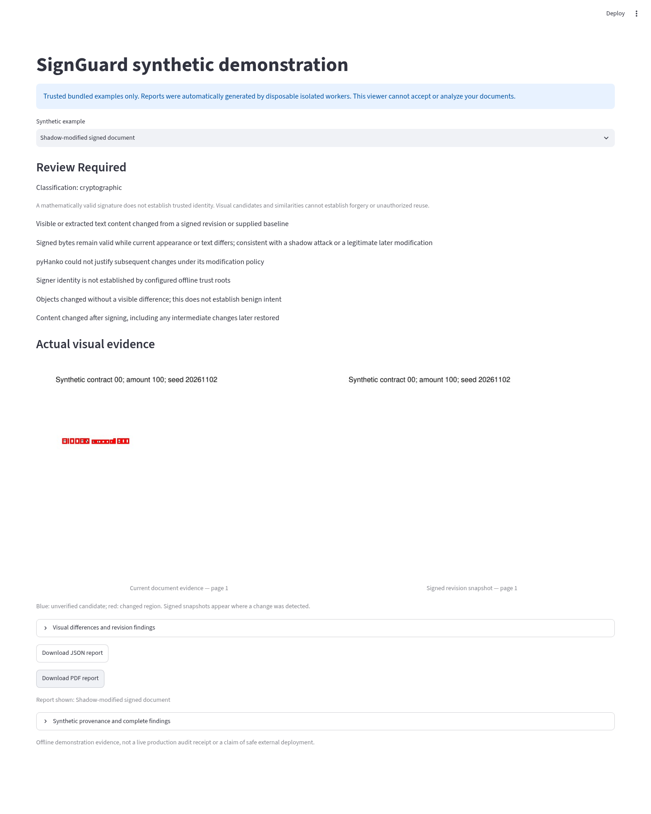

# SignGuard synthetic-only and private demonstrations

## Phase 9: AWS deployment preparation

[PR #10](https://github.com/Saisathwik045/signguard/pull/10) prepares a single-host AWS staging deployment from merged Phase 8 main. It preserves the existing synthetic Site and live-analysis pipeline. Terraform has separate spending/maintenance-ingress gates, encrypted retained audit storage, OIDC/SSM deployment, immutable scanned image publication and a separate rootless worker daemon. The new HTTPS gateway reuses existing Authlib/ASGI, authorizes one immutable GitHub owner ID and persists bounded sessions/quotas. Uploads remain disabled in generated staging configuration.

**No AWS resources have been provisioned and no live-upload URL exists.** Recommended low-use cost is about $40/month plus usage/taxes; no verified free tier supports the complete tested x86 stack. Actual AWS host, public TLS issuance/renewal, GitHub login, audit recovery and rollback must be verified before release. See [provider comparison](HOSTING_COMPARISON.md) and [browser-only authorization/runbook](deploy/aws/README.md).

## Phase 8 live analysis evidence — cloud tests, not a deployed upload URL

The live application offers PDF upload after authentication, optional baseline/signature images,
isolated-analysis progress, crypto validity/trust details, highlighted candidate/change regions,
current/signed images, clear limitations and JSON/PDF downloads. Unsupported encrypted/malformed PDFs
have JSON reasons and no invented PDF evidence. Five supported examples still abstain on identity.

Open the PR's **Private staging integration** Actions artifact `authenticated-browser-evidence` to see
real cloud container-browser screenshots, seven JSON outcomes, five generated PDF downloads, audit
chain, exact worker identity, JUnit and fresh scans. Each visible forensic image is separately captured
so screenshots do not hide evidence below Streamlit's scroll container. `live-verification.json` records
the tested scope; it explicitly reports external staging/TLS/production OIDC as false.

The existing owner-private synthetic URL above remains the only deployed demonstration. No upload
controls or backend were added to it. No local installation, local command or Codespaces is needed.
See RESULTS.md for successful and failed runs; the preliminary Codex VFS disk exhaustion and separate
synthetic-container startup failures are not represented as passed hosted tests.

Actual live-container screenshot: [shadow analysis](evaluation/phase8/live-stack/03-shadow_reveal.png).
Forensic captures: [current appearance](evaluation/phase8/live-stack/03-shadow_reveal-evidence-0.png)
and [signed revision](evaluation/phase8/live-stack/03-shadow_reveal-evidence-1.png).
These are cloud test-stack screenshots, not screenshots of an external upload deployment.

## Verified scope and owner observation — 3 November 2026

The owner confirms opening the deployed private viewer successfully at
https://signguard-private-synthetic.knitdeck.chatgpt.site. This is a user-reported browser observation;
independent automated authenticated hosted testing remains unverified under the current Codex policy.
No network setting needs to be changed for the completed artifact checks. All five examples, evidence
images and ten exact downloads passed fresh cloud artifact-browser testing; corrupted report bytes
fail closed, and late responses cannot replace a newer selected report.

See [DEPLOYMENT_VERIFICATION.md](DEPLOYMENT_VERIFICATION.md) for the checklist separating observations,
control-plane metadata, actual anonymous HTTPS probes and loopback automation. No uploads, URL/path
inputs or analysis backend were added. Historical statements below refer to earlier phases only.

## Phase 7 private browser link

[Open SignGuard Private Synthetic Lab](https://signguard-private-synthetic.knitdeck.chatgpt.site)

Sites confirms the private publication succeeded. Sign in with the owner ChatGPT account; no other
users/groups/external visitors are allowed by the current policy. This is a static presentation of
the five actual synthetic reports, not the Streamlit upload application or a live PDF-processing backend.
Select a document on the left to inspect its classification, explanation, current/signed evidence,
revision data and actual JSON/PDF downloads. There is no upload, URL or path entry.

The artifact passed real cloud Chromium tests for all five examples and exact downloads. The
**hosted authorized browser test is not yet verified**: this Codex environment denies HTTPS CONNECT
to the Site hostname. Do not interpret publication success or localhost screenshots as hosted-browser
success. The minimum remaining browser-based configuration is adding
`signguard-private-synthetic.knitdeck.chatgpt.site` to Codex Cloud's allowed outbound hosts.

An independent Actions job tests anonymous access to the actual hosted page/assets/report routes.
That real HTTPS probe passed in [run 41608991009](https://github.com/Saisathwik045/signguard/actions/runs/41608991009):
the homepage, health, catalogue, script and report routes all denied anonymous requests with HTTP 403.
Protected hosted health/browser tests are prepared; service-credential automation is distinguished
from interactive owner SSO. No account purchase, local setup or Codespaces is needed.

## Current synthetic-only viewer

The separate `synthetic_demo.py` offers exactly five bundled examples through a dropdown. No
upload, external URL or filesystem-path input exists. Classification and explanations are actual
forensic results automatically generated by disposable Docker workers, then validated against
bundled PDF/report SHA-256 digests. Selecting an example displays its existing verified report;
the viewer never parses PDFs or launches analysis. The shadow example includes current and signed
snapshots. Both JSON and generated PDF triage reports can be downloaded from the UI.

| Example | Classification | Actual triage verdict |
| --- | --- | --- |
| Genuine signed | cryptographic | inconclusive; identity trust is not established |
| Tampered signed bytes | cryptographic | tampering detected |
| Shadow-modified | cryptographic | review required |
| Visual-only signature | visual_candidate | inconclusive |
| Unsigned | unsigned | inconclusive |

Open this integration branch's **Synthetic-only cloud demo** Actions run for screenshots, actual
download checks, JUnit, generation/image provenance and fresh scans in the
`synthetic-demo-security-and-browser-evidence` artifact. The catalogue and reports are also in
`src/signguard/demo_assets/`. Chromium tests each example's image and JSON/PDF download, checks
that reports correspond to the selected PDF, and confirms there is no file input.

Cloud automation uses `python -m scripts.build_synthetic_demo --analyze` after building the worker;
the fixed trusted fixtures can be regenerated with `--generate`. These are CI/cloud-maintainer
operations, not local user setup. No private signing key or user document is bundled. Five examples
are an integration demonstration, not a new accuracy benchmark or evidence that all attacks are detected.

**Historical Phase 5 scope:** no external demo URL existed then. The private Phase 7 URL above
is now published; authenticated hosted automation remains unverified. Codespaces is not required. Before any external route,
resolve the relevant image findings and verify private hosting, TLS and access controls.

The Codex Chromium run passed all five example navigations, real PNG decoding, report selection,
and ten JSON/PDF downloads in one browser scenario. Five actual screenshots and successful JUnit
are retained in `evaluation/cloud-recovery/`. This run uses the cloud-process viewer; container
browser scope is tested separately in Actions. A real container probe also verified all five bundles
and the absence of PDF parser/client/executor modules. Slow VFS container creation exposed a test
startup/cleanup race; the harness now awaits creation before polling health and removing the container.

Verified implementation run: [Synthetic-only cloud demo 41495817951](https://github.com/Saisathwik045/signguard/actions/runs/41495817951)
passed the full container-hosted browser scenario and retained
[27 evidence files](https://github.com/Saisathwik045/signguard/actions/runs/41495817951/artifacts/13166068310),
including freshly generated fixture reports, screenshots, JUnit and worker/viewer scans. The
[authenticated upload integration](https://github.com/Saisathwik045/signguard/actions/runs/41495817821)
also passed all 11 browser cases. These are completed cloud tests, not a deployed preview URL.

## Historical authenticated upload integration

## What has actually run

The cloud browser suite signs into a credential-protected app, uploads synthetic documents, calls
an authenticated private controller, crosses the restricted Unix RPC boundary, launches disposable
Docker PDF workers, renders returned evidence, and downloads JSON/PDF reports. Screenshot and report
artifacts are generated by Chromium, not mockups. No forensic parsing/rendering occurs in the UI.

The Codex Cloud run uses a non-root Streamlit process, a controller container and Docker workers;
its limited VFS disk prevented keeping a running UI container alongside the other tiers. The GitHub
Actions browser job uses containers for all three tiers and records its actual run result separately.
The browser URL is a real cloud **loopback test URL**, not a user-accessible hosted preview.

## See the demonstration remotely now

Open this feature branch's **Private staging integration** workflow in GitHub Actions. A completed
run retains `authenticated-browser-evidence`: screenshots, downloaded reports, JUnit, audit events,
fixture PDFs and route scope metadata. The repository also includes example evidence in
`evaluation/phase4/`. This is an artifact demonstration, not a live hosted service.

## Current private preview status — Phase 6

No private/external URL has been deployed or verified. Development and browser tests run in Codex
Cloud and GitHub Actions; Codespaces is not required. The final worker's fresh full scan now has
0 CRITICAL/HIGH findings, and its actual installed Python audit has 0 advisories. Baseline findings
and all CVE dispositions are preserved in `evaluation/phase6/`. The actual final image, not a
candidate, is checked by image ID. Medium/low findings remain visible.

The five bundled reports were regenerated by the Phase 6 worker. The synthetic viewer remains
read-only and independent of worker/controller authority. The production upload application still
requires all-route authentication, private TLS routing, restricted executor hosting, runtime-only
credentials, quotas and durable audit policy. A clean image scan does not satisfy those gates.
No preview listener is left exposed, and no public upload route was opened.

## Before enabling a preview port

Complete a new full image scan and all release gates. The Phase 6 worker image gate passes;
external ingress remains blocked by the independent deployment controls. `python -m signguard.release_gate EVIDENCE_DIR`
rejects missing/failed controls, invalid test/scan artifacts and unverified private HTTPS routing.
The false-by-default `deploy/release.example.json` is not a release attestation.

A Codespaces route must be explicitly PRIVATE, protected by GitHub account authentication and TLS,
and verified with both signed-in and signed-out browser probes. The devcontainer's PRIVATE
visibility is a forwarding default, not evidence that a port was actually forwarded or verified.
Application preview login is an
additional single-owner credential gate with a 15-minute session lifetime and bounded attempts.
It is not a replacement for production OIDC identity/tenant controls. Never paste preview credentials
into commits, screenshots, workflow logs or public issues. Real OIDC remains the default production mode.

## Demonstration cases

- Genuine signed: cryptographic classification, usually inconclusive without configured trust roots.
- Signed-byte tampering: tampering detected, with cryptographic evidence.
- Shadow reveal: review required, current evidence and signed revision images.
- Visual-only: unverified visual candidate; no assertion of identity or unauthorized copying.
- Unsigned: no cryptographic signature evidence; inconclusive does not mean authentic.
- Encrypted/malformed: explicit unsupported/error state, no clean report or unsafe fallback.

Blue boxes show unverified candidates; red boxes show changed regions. The PDF report is a generated
triage summary, not a newly signed source PDF. The JSON includes a controller-local audit receipt;
its head is not externally anchored. Downloads persist through browser reruns but are cleared on
logout, changed uploads and session expiry. Only synthetic documents belong in the staging canaries.

The Codex loopback browser run used a host UI process sharing the trusted test UID/filesystem;
it is not proof that the UI itself is sandboxed. Its PDF workers were isolated and no external
route was opened. The CI all-container path must pass before claiming UI filesystem separation.
Application widget authorization alone does not protect every Streamlit HTTP endpoint: an authenticated
private gateway must protect uploads, WebSockets and downloads before any untrusted-user ingress.

`deploy/private-preview.compose.yaml` wires the authenticated gateway without requiring an external
OIDC registration. It still binds only loopback and needs the privileged host executor, private audit
permissions and release-gate clearance. A real externally reachable route has not been verified.
The alternative Debian 13 scan still had 45 high findings; it was not adopted to hide the current
worker's 36 high and 2 critical OS findings. No vulnerability exceptions or release gates were waived.

## Verified remote evidence

[All-container browser run](https://github.com/Saisathwik045/signguard/actions/runs/41413174237)
and [regression/security run](https://github.com/Saisathwik045/signguard/actions/runs/41413174218)
passed for implementation commit `711a2c4`. This is verified cloud integration, not deployment approval.

The image above is a real Chromium capture using only synthetic documents. Additional screenshots
are browsable in `evaluation/phase4/screenshots/` on GitHub without local commands or installations.
All downloads and scan artifacts remain in the Actions run.

To continue toward a live URL, an authorized private staging host and verified TLS/identity routing
are still required after all image and deployment gates pass. Codex Cloud/Actions remain the only
required development platforms. Do not paste tokens or secrets into chat.
