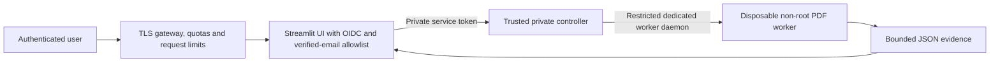

# Private cloud deployment preparation — not deployed

## Architecture

A cost-conscious starting point is a small dedicated Linux VM, sized for at least one 1 GiB worker
plus the UI/controller and OS overhead. Compare current provider prices before provisioning.
Single concurrency limits cost and attack surface; horizontal scaling requires a real quota service.

Workers have no network, mounted credentials, host directories or persistent uploads. The UI must
never parse the PDF in-process in production or receive Docker socket access. Controller socket
access is privileged: use a dedicated rootless/restricted daemon before production. The Compose
example demonstrates wiring; it is not a verified hardened production installation.

## Definitions and secrets

- `deploy/Dockerfile.worker`: tested build and disposable execution, dependency constraints, non-root UID.
- `deploy/Dockerfile.ui`: development/private UI candidate; OIDC is required in production mode.
- `deploy/Dockerfile.controller`: private controller candidate with Docker CLI; requires restricted socket access.
- `deploy/compose.yaml`: localhost-only UI port, no published controller port, read-only services and limits.
- `deploy/environment.example` and `oidc-secrets.example.toml`: placeholders only. Real values belong
  in a cloud secret manager, not Git or worker environment. Streamlit secrets must be readable by
  the UI UID without being world-readable. The service token must have at least 32 random characters.

The UI image defaults to `SIGNGUARD_REQUIRE_AUTH=true` and `SIGNGUARD_BACKEND=broker`. Production
refuses the subprocess fallback. Configure explicit verified-user emails and OIDC provider metadata,
client ID/secret, cookie secret and HTTPS callback URL. An arbitrary domain or unverified email is
not authorization. Actual provider integration is an open gate, not a completed deployment step.

## Cloud build and validation

All execution is in Codex Cloud/GitHub-hosted environments. There is no local Docker requirement.
GitHub Actions `Cloud tests` runs regressions, independent Poppler checks, dependency/static scans,
container builds, runtime resource tests and benchmark smoke. The manual `Build private deployment
candidates` workflow builds all three images and saves a short-lived artifact; it has no deployment
credentials, registry publication, ingress creation or production release action.

In managed Codex Cloud, use its existing Docker proxy settings and build-secret CA guidance. Never
copy session credentials/CA secrets into image layers or disable TLS verification. The cloud's VFS
storage driver can duplicate large image layers: this session hit its 7.9 GiB root disk limit while
building all candidates. Disposable build-cache cleanup recovered space; completed and incomplete
image verification is recorded in PROJECT_STATUS.md. All three images subsequently built; UI/controller
liveness and private controller denial probes passed, but full Compose/OIDC routing remains unverified.
This capacity problem did not change detector source
code, input labels, detector thresholds or measured outcomes.

## Release gates and rollback

Do not expose even a private upload service to users until SECURITY.md's mandatory gates are met.
Then an authorized operator must review measured controls, complete OIDC/TLS/quota validation,
scan OS/image dependencies, build immutable image digests and retain the last known good digests.
Apply configuration first to a restricted staging environment with synthetic documents only.
Verify health, actual sign-in/denial, worker no-network/read-only behavior, cgroup enforcement,
timeouts, cleanup, report authorization and load limits before approving ingress.

For rollback, close ingress/disable submissions first, drain or terminate active workers, restore
previous verified UI/controller/worker image digests and compatible configuration/secrets, rerun
synthetic canaries and authentication tests, then reopen only after approval. There are no schema
migrations or persistent upload stores in this implementation. Do not roll back to vulnerable Pillow
or pip versions merely to restore an older application image. Worker timeouts/errors must fail closed.

## External requirements

Still needed: hosting/account authorization, dedicated worker infrastructure, restricted daemon or
sandbox service, domain/TLS, OIDC client registration and secrets, verified-user policy, gateway
quotas, retention policy, OS vulnerability review and staging/load-test approval. No provider account
was provisioned, no public endpoint was created, and no production secrets were requested or installed.
