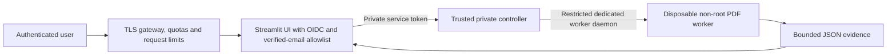

# Cloud deployment — private synthetic presentation published

## Phase 9: AWS deployment preparation

[PR #10](https://github.com/Saisathwik045/signguard/pull/10) prepares a single-host AWS staging deployment from merged Phase 8 main. It preserves the existing synthetic Site and live-analysis pipeline. Terraform has separate spending/maintenance-ingress gates, encrypted retained audit storage, OIDC/SSM deployment, immutable scanned image publication and a separate rootless worker daemon. The new HTTPS gateway reuses existing Authlib/ASGI, authorizes one immutable GitHub owner ID and persists bounded sessions/quotas. Uploads remain disabled in generated staging configuration.

**No AWS resources have been provisioned and no live-upload URL exists.** Recommended low-use cost is about $40/month plus usage/taxes; no verified free tier supports the complete tested x86 stack. Actual AWS host, public TLS issuance/renewal, GitHub login, audit recovery and rollback must be verified before release. See [provider comparison](HOSTING_COMPARISON.md) and [browser-only authorization/runbook](deploy/aws/README.md).

## Phase 8 deployment decision: live staging BLOCKED

The implementation is tested through the cloud-only private-preview stack, not externally deployed.
No actual user-accessible live-upload staging URL exists. The deployed owner-private synthetic Site
is unchanged and must remain independent of parser/controller/executor services. It cannot host Python
or a restricted disposable-worker runtime. This task's current cloud environment has no bound hosting
identity or deployment secret; GitHub CI permission is not infrastructure provisioning authority.

Existing `deploy/compose.yaml`, `private-preview.compose.yaml`, Dockerfiles, environment/secret examples
and executor service remain preparation artifacts. The preview password gateway is for controlled tests;
production OIDC and all-route gateway integration require real provider registration and verification.
UI image now packages the tracked Streamlit theme/config. Controller has no Docker CLI/socket; only
restricted Unix RPC to the trusted executor. That executor still has daemon authority and needs a
qualified dedicated/rootless runtime. Production must configure immutable image references, not legacy
phase tag defaults. Never publish the controller or raw Streamlit service around the gateway.

Before authorized staging, supply an approved dedicated runtime account/identity (no paid provisioning
without explicit approval), private TLS endpoint/routing, OIDC client/issuer/audience/redirect and user
allowlist, secret-manager/CI workload identity, restricted executor host, shared quota service and durable
audit sink/anchoring/retention. Validate actual cgroups, denied egress, no worker secrets, cleanup under
cancellation/restart/disk pressure, signed-in/out media/WebSockets and cross-user denial. Run synthetic
uploads and verify exact reports over real HTTPS before releasing a narrow allowlist. No current control
is inferred from a Boolean in the prepared release template; `release_gate` defaults stay false.

CI now checks downloaded live reports against the audit chain and actual worker image ID, captures
real forensic-image screenshots and scans the actual built service images. Tests stay loopback-only.
Rollback preparation remains: close submissions/ingress, drain/kill jobs, restore clean digests/config,
verify audit continuity and auth/synthetic canaries, then reopen only after reviewed release evidence.
Minimum external next step after code review: browser-authorize a qualified dedicated cloud runtime
and register production OIDC. No laptop commands, Codespaces, token sharing or paid signup is required
for the engineering already completed; no claim is made that these external requirements are configured.

## Phase 7 closeout and immutable viewer — 3 November 2026

PR #7 is merged into main `0c8f74c`. The current private Site remains active at version 2 with unchanged
owner-only policy. The owner reports successful browser access. Native metadata and retained source
were checked without redeployment; regenerated static files match native source commit `4c56398`
byte-for-byte. The control-plane deployment/version/archive identifiers remain in `deploy/private-site.json`.
Authenticated live bytes, interactive SSO and a rollback drill remain independently unverified.

All four PR-head workflows were rechecked successfully; hosted-validation was skipped. Automated
artifact evidence and the exact verification checklist are linked in
[DEPLOYMENT_VERIFICATION.md](DEPLOYMENT_VERIFICATION.md). No current network-policy change is required
or made for this closeout. Earlier browser allowlist instructions below are optional future hosted-QA
preparation, not a requirement to use the viewer or a request to repeat environment setup.

[NEXT_PHASE_PLAN.md](NEXT_PHASE_PLAN.md) specifies a separate private upload staging architecture,
provider qualification, identity and resource controls, staged delivery and rollback gates. This is a
technical plan only: no billable infrastructure, domains, live upload backend or production secrets
were provisioned. Preserve the existing private snapshot Site as an independent service.

## Phase 7: private static presentation published; upload service not deployed

The connected Sites service is selected **only** for the independent synthetic presentation tier.
It does not host Python/Streamlit or the privileged worker architecture. The original synthetic
Streamlit and production Docker definitions are preserved. Current official provider terms and
why no paid/provider account was provisioned are recorded in [HOSTING_COMPARISON.md](HOSTING_COMPARISON.md).

Native publication succeeded at `https://signguard-private-synthetic.knitdeck.chatgpt.site`, with an
owner-only access policy. Exact IDs/source provenance are in `deploy/private-site.json`. Deployed
assets are produced by `scripts/build_private_viewer.py` from validated bundled reports only.
No parser, daemon, process launch, file write or backend token is shipped. Client loads are bounded
by five fixed reports (each capped at 1 MiB at build time), no external dependencies/origins, and
platform limits. Authentication/TLS/cookies are managed by Sites, not a new application password store.

The packaged Site source is a separate native source repository containing only the static artifact,
checksums and the provider hosting manifest. The standard Sites helper was not installed/readable in
this cloud executor; `scripts/site_source.py` implements the same push/commit/archive provenance
invariants using hidden-stdin credentials, in-memory Git headers and git archive of the pushed commit.
No credentials are persisted. Publication uses the native owner-private tool after source synchronization.

CI automatically validates/builds/checksums/packages the viewer and retains browser evidence. An
anonymous hosted probe requires no secrets. Optional hosted validation requires the protected
`private-synthetic` environment variables `SIGNGUARD_SITE_URL` and secret `SIGNGUARD_SITE_BEARER`.
Missing access fails closed. Publication still requires the native Sites connection and fresh source
credential; this is not an unattended CD claim using an expiring token stored in GitHub.

Health endpoint: `/health.json`, behind the same private gate. Expected mode `synthetic-only`, five
cases, uploads/backend false. Authorized health and hosted browser tests remain blocked in Codex
until the exact hostname is allowed by its outbound policy. No insecure networking workaround is
permitted. On a bad release, redeploy the prior known-good saved version through the native private
deployment tool, preserve owner-only policy, and rerun health/anonymous/authorized browser probes.
Version 2 preserves exact worker JSON bytes on download, so its SHA-256 matches the displayed
provenance. Version 1 remains historical but reserializes JSON and is not the preferred integrity
baseline. After hosted QA, version 2 is the rollback baseline for future releases; no rollback drill
or successful interactive login is claimed. No production upload ingress is approved.

### Exact outbound-host change (authorized, not applied by this task)

This executor exposes network-policy inspection, not mutation. The active enforced configuration
still has no custom allowed hosts. In the browser, open Settings → Codex Cloud → Environments,
choose signguard's … → Edit, retain restricted/public-internet-off mode and the existing package
manager allowance, and add `signguard-private-synthetic.knitdeck.chatgpt.site` under Additional allowed
domains. Save and republish once. New tasks use the updated environment; existing tasks keep their
state. This is one policy update, not a project rebuild. See the
[official guide](https://learn.chatgpt.com/docs/environments/cloud-environments#connect-to-services).
Only HTTPS origins matching `deploy/private-site.json` are accepted by QA, with TLS verification on.
Neither this grant nor service-auth QA is represented as a completed interactive owner SSO test.

## Phase 6 image configuration

All service Dockerfiles now use the digest-pinned maintained Ubuntu 26.04 runtime. The worker has
native Python 3.14, unchanged forensic library pins and Poppler; it contains no pip/compiler/bootstrap
tools. UI requirements are installed in a separate stage and copied into the worker-derived runtime.
The controller still has no Docker CLI/socket, and the synthetic viewer still has no forensic parser,
upload input or execution authority. Existing non-root/read-only/network/cgroup/tmpfs restrictions remain.

The exact Codex final worker `sha256:99179020dfe24c921cbd75603df7cfae4afa490ae621c9d2cd54967cc3a84a28`
passed the full image gate (0 CRITICAL/HIGH) and installed dependency audit (0 advisories).
`scripts/scan_image.sh` performs unfiltered full-image scanning; `scripts/image_inventory.py` audits
without restoring pip; `scripts/verify_image_scan.py` requires exact image identity and rejects even
lower-severity reappearance of original CVEs. CI strictly enforces findings and scans actual built
worker/UI/controller/demo images. Digest pinning plus recorded inventories identify tested artifacts;
APT security repositories can change between rebuilds, so new builds always require fresh scans/tests.

No production route was enabled. Clearing the image gate does not prove private TLS, external
authentication/authorization, dedicated/rootless executor hosting, durable audit storage or operational
isolation. Those gates remain mandatory and false by default. Do not deploy from a candidate scan.

## Historical deployment notes

## Separate synthetic-only build candidate

`deploy/Dockerfile.demo` packages only the Streamlit viewer and verified synthetic catalogue.
`deploy/synthetic-demo.compose.yaml` defines a non-root/read-only viewer with dropped capabilities,
no-new-privileges, bounded CPU/memory/PIDs/tmpfs and a loopback-only port. It has no uploads,
production broker credentials, executor socket or Docker access. This is separate from the existing
private upload-service definitions; it does not replace their authentication or worker boundary.

The **Synthetic-only cloud demo** workflow automatically builds the final worker, reanalyzes all
bundled PDFs in disposable containers, builds the viewer, verifies absence of parser/executor modules,
drives container-hosted Chromium smoke tests and retains reports/screenshots/JUnit/scan artifacts.
Fresh worker and viewer OS scans produce explicit release-admission evidence; green functional CI
never approves external ingress. Installed worker Python packages are audited independently of SBOMs.

No Codespaces, local execution, public port or paid provisioning is required for this workflow.
No external demonstration URL is available. The current final worker scan has 2 CRITICAL and
36 HIGH OS findings. External upload ingress remains blocked pending remediation, private TLS
routing, authentication/authorization probes, restricted executor authority and durable audit storage.
The synthetic viewer also needs its own image and private-host/TLS assessment before external use.

## Architecture

A cost-conscious starting point is a small dedicated Linux VM, sized for at least one 1 GiB worker
plus the UI/controller and OS overhead. Compare current provider prices before provisioning.
Single concurrency limits cost and attack surface; horizontal scaling requires a real quota service.

Workers have no network, mounted credentials, host directories or persistent uploads. The UI must
never parse the PDF in-process in production or receive Docker socket access. Controller socket
access is privileged: use a dedicated rootless/restricted daemon before production. The Compose
example demonstrates wiring; it is not a verified hardened production installation.

## Definitions and secrets

- `deploy/Dockerfile.worker`: tested build and disposable execution, dependency constraints, non-root UID.
- `deploy/Dockerfile.ui`: development/private UI candidate; OIDC is required in production mode.
- `deploy/Dockerfile.controller`: private controller candidate with Docker CLI; requires restricted socket access.
- `deploy/compose.yaml`: localhost-only UI port, no published controller port, read-only services and limits.
- `deploy/environment.example` and `oidc-secrets.example.toml`: placeholders only. Real values belong
  in a cloud secret manager, not Git or worker environment. Streamlit secrets must be readable by
  the UI UID without being world-readable. The service token must have at least 32 random characters.

The UI image defaults to `SIGNGUARD_REQUIRE_AUTH=true` and `SIGNGUARD_BACKEND=broker`. Production
refuses the subprocess fallback. Configure explicit verified-user emails and OIDC provider metadata,
client ID/secret, cookie secret and HTTPS callback URL. An arbitrary domain or unverified email is
not authorization. Actual provider integration is an open gate, not a completed deployment step.

## Cloud build and validation

All execution is in Codex Cloud/GitHub-hosted environments. There is no local Docker requirement.
GitHub Actions `Cloud tests` runs regressions, independent Poppler checks, dependency/static scans,
container builds, runtime resource tests and benchmark smoke. The manual `Build private deployment
candidates` workflow builds all three images and saves a short-lived artifact; it has no deployment
credentials, registry publication, ingress creation or production release action.

In managed Codex Cloud, use its existing Docker proxy settings and build-secret CA guidance. Never
copy session credentials/CA secrets into image layers or disable TLS verification. The cloud's VFS
storage driver can duplicate large image layers: this session hit its 7.9 GiB root disk limit while
building all candidates. Disposable build-cache cleanup recovered space; completed and incomplete
image verification is recorded in PROJECT_STATUS.md. All three images subsequently built; UI/controller
liveness and private controller denial probes passed, but full Compose/OIDC routing remains unverified.
This capacity problem did not change detector source
code, input labels, detector thresholds or measured outcomes.

## Release gates and rollback

Do not expose even a private upload service to users until SECURITY.md's mandatory gates are met.
Then an authorized operator must review measured controls, complete OIDC/TLS/quota validation,
scan OS/image dependencies, build immutable image digests and retain the last known good digests.
Apply configuration first to a restricted staging environment with synthetic documents only.
Verify health, actual sign-in/denial, worker no-network/read-only behavior, cgroup enforcement,
timeouts, cleanup, report authorization and load limits before approving ingress.

For rollback, close ingress/disable submissions first, drain or terminate active workers, restore
previous verified UI/controller/worker image digests and compatible configuration/secrets, rerun
synthetic canaries and authentication tests, then reopen only after approval. There are no schema
migrations or persistent upload stores in this implementation. Do not roll back to vulnerable Pillow
or pip versions merely to restore an older application image. Worker timeouts/errors must fail closed.

## External requirements

Still needed: hosting/account authorization, dedicated worker infrastructure, restricted daemon or
sandbox service, domain/TLS, OIDC client registration and secrets, verified-user policy, gateway
quotas, retention policy, OS vulnerability review and staging/load-test approval. No provider account
was provisioned, no public endpoint was created, and no production secrets were requested or installed.

## Phase 4 integration update

The controller no longer has a Docker CLI or daemon socket. A trusted host executor exposes only a
bounded analysis RPC on a group-restricted Unix socket; image, executable, mounts, UID, networking and
resource flags cannot be supplied by a request. `deploy/signguard-executor.service` prepares that host
boundary. The executor retains privileged daemon access and belongs on a dedicated/restricted host.
The UI receives only the private HTTP controller endpoint and service token, never either socket.
Compose now mounts the RPC directory read-only into the controller and a separate private audit sink.

Authentication precedes uploads. Production keeps OIDC/verified-email authorization. The explicit
single-owner private-preview mode uses a salted scrypt credential, 15-minute in-memory sessions,
server login rate limiting, and no implicit trust in forwarded identity headers. It requires the
isolated broker backend and an explicitly confirmed private environment. This flag alone is not
proof that a real cloud URL is private; the release attestation and external route probes are separate.

`Private staging integration` builds all images and drives Chromium through the complete stack,
retaining screenshots, JSON/PDF downloads and audit evidence. It creates no external ingress.
`release.example.json` defaults all controls to false. The release validator requires successful
browser tests, verified private HTTPS routing, matching artifact hashes and clean OS/dependency scans.
A passing loopback integration test is insufficient authorization to publish a port.

See DEMO_GUIDE.md for the browser-only handoff. Codespaces creation/access was unavailable from this
runtime; the Codespaces API is blocked by its proxy and no provider identity is bound. No live preview
URL has been tested, no paid hosting was created, and production OIDC/TLS remains unverified.

The Codex loopback browser run used a host UI process sharing the trusted test UID/filesystem;
it is not proof that the UI itself is sandboxed. Its PDF workers were isolated and no external
route was opened. The CI all-container path must pass before claiming UI filesystem separation.
Application widget authorization alone does not protect every Streamlit HTTP endpoint: an authenticated
private gateway must protect uploads, WebSockets and downloads before any untrusted-user ingress.
