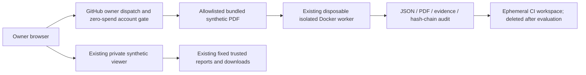

# Phase 10: strict ₹0 cloud architecture

Verified research: 5 November 2026 (India Standard Time). Phase 9 merged as PR #10, main `ccc5995`. The financial requirement supersedes the AWS recommendation; all forensic functionality and historical results are preserved.

## Decision and implemented boundary

Keep the existing owner-private synthetic Site unchanged. Use Codex Cloud's already-provided workspace for development and **gated standard public-repository GitHub Actions for project tests only**. No paid VM, object store, networking, domain, cloud account upgrade, registry publication or arbitrary-upload endpoint is provisioned. The Site's connected-account pricing/entitlements are not exposed here; its pre-existing contractual cost cannot be certified by repository code.

The fresh CI results are **not** automatically published into the existing Site. The owner can read CI classifications when a permitted run completes. Remote binary artifacts/caches are disabled to avoid storage exposure. The Site continues to provide its existing verified JSON/PDF/evidence downloads.

**Private arbitrary-input transfer and authenticated retrieval of fresh private analysis reports are unavailable.** No private PDFs may enter source, issue attachments, workflow inputs, dispatch JSON, public artifacts or logs. GitHub Actions is not used as a serverless service, public upload backend, queue for customers or tunnel host. The finite synthetic job is software development/evaluation within the repository.

## Provider comparison

| Service | Card/billing and strict ₹0 status | Runtime / isolation / access / persistence | Shutdown and terms |
| --- | --- | --- | --- |
| Standard GitHub-hosted Actions, public repo | Standard public-runner compute is free; storage/account-wide usage can be metered. Account no-spend controls are unverified, so jobs default to skipped. No payment details needed for the recommended public development path. | Full native Python/OpenCV/pyHanko/Poppler stack on a VM; existing Docker isolation and separate rootless qualification available. Public logs/results are unsuitable for private documents. Runner disk is ephemeral; no durable external audit store is provided. | Finite job timeouts; disposable VM. Development/testing only, not a live service. |
| GitHub private repo / artifacts / caches | Private-runner quotas can exhaust; artifact/cache allowances are not an unlimited storage promise. Remote uploads/caches removed from active workflows. | Repository permissions can restrict retrieval, but the current public repository is not private transfer/storage. No private-input workflow was built. | Retention and account limits apply. A private repo or encryption alone does not establish zero spending or service-policy compliance. |
| GitHub Codespaces | Personal included quota is not a charge guarantee. Overage and persistent storage exposure exist. | Technically supports a development VM, but user has excluded Codespaces and terms restrict production hosting. | Idle stops and quota exhaustion; not used. |
| Oracle Always Free A1 | Card verification required; Oracle describes temporary authorization holds. Non-upgraded Always Free account required by our offline precheck. No account, capacity or entitlement is connected/verified. No signup/upgrade/provisioning performed. | A Linux ARM VM is a plausible full-stack host with cgroup v2/rootless Docker, private OAuth/HTTPS and encrypted persistent audit disk; actual enforcement and ARM stack must be tested. | Capacity shortages and idle reclamation; no SLA. Not currently an operational ₹0 deployment. |
| Google Cloud Run allowance | Billing account required; paid-account overage bills. Trial expires and does not establish permanent free hosting. Not selected. | Authenticated HTTPS/container frontend possible, but current nested disposable-Docker architecture is not qualified there. Full native workers require a separately reviewed backend. Filesystem is not durable audit storage. | Scales down/instance lifecycle; free allowance is not a spending stop. |
| Cloudflare Pages / Workers Free | Published free-plan limits exist; paid features and separately billed products must remain off. No new account/card/upgrade requested. Existing Sites pricing is a separate contract, not assumed identical. | Good static presentation; Workers' 128 MB/short CPU allowance and lack of a Docker daemon cannot run this native forensic stack. Python/WASM does not replace Poppler/OpenCV container isolation. Access/private policies require actual configuration. | Requests fail at free limits. Static Pages does not supply the required worker host or immutable audit backend. |

Primary sources checked:

- [GitHub compute/storage billing](https://docs.github.com/en/billing/concepts/product-billing/github-actions), [runner specifications including ARM64](https://docs.github.com/en/actions/reference/runners/github-hosted-runners), [product allowances](https://docs.github.com/en/billing/reference/product-usage-included).
- [GitHub storage/retention update](https://github.blog/changelog/2026-08-27-actions-retention-will-cover-checks-workflow-runs-and-statuses/), [hard budgets](https://docs.github.com/en/billing/how-tos/set-up-budgets), [Actions and Codespaces terms](https://docs.github.com/en/site-policy/github-terms/github-terms-for-additional-products-and-features), [Codespaces billing](https://docs.github.com/en/billing/concepts/product-billing/github-codespaces).
- [Oracle current Always Free resources](https://docs.oracle.com/en-us/iaas/Content/FreeTier/freetier_topic-Always_Free_Resources.htm), [card/eligibility FAQ](https://www.oracle.com/cloud/free/faq/).
- [Cloud Run pricing](https://cloud.google.com/run/pricing), [Google billing/trial requirements](https://docs.cloud.google.com/free/docs/free-cloud-features).
- [Cloudflare Workers pricing](https://developers.cloudflare.com/workers/platform/pricing/), [runtime limits](https://developers.cloudflare.com/workers/platform/limits/), [Pages build limits](https://developers.cloudflare.com/pages/platform/limits/).

## Oracle conditional feasibility and preparation

Current Oracle resource documentation lists 1,500 OCPU-hours and 9,000 GB-hours monthly (roughly 2 OCPU/12 GB), 200 GB combined boot/block storage in the home region, and limited free backups/object storage. Do not copy older 4 OCPU/24 GB claims. Existing tenancy consumption must be subtracted. A conservative potential pilot is **one A1 CPU, 6 GiB RAM, 50 GiB boot disk**, no ingress initially. This is a capacity hypothesis, not a verified deployment.

`deploy/oracle/free-only.example.json` and `scripts/oracle_free_eligibility.py` implement an offline deny-by-default precheck: non-upgraded post-trial account, home region, free label, spare account-wide quotas, capacity, ARM qualification and closed ingress. It rejects non-finite/negative quota values and has **no create-resource operation**. Passing user-entered booleans is not authoritative account proof or a billing guarantee. No executable Oracle Terraform apply is supplied while capacity/identity/billing are unverified.

`evaluation/phase10/arm-wheel-metadata.json` records current PyPI ARM/pure wheel availability for eight pinned key packages. The existing Ubuntu digest is a multi-architecture index containing ARM64; `base-manifest.json` records that metadata. This does not prove Python ABI resolution, Poppler installation, native imports, OpenCV behavior, cgroup controls or full forensic output. A prepared `ubuntu-24.04-arm` job builds/tests/scans the **actual existing worker image** once the zero-spend gate is satisfied. No ARM CI run or Oracle VM was claimed here.

Oracle would additionally need owner approval for card verification/holds and account creation, verified non-upgraded tenancy and home-region capacity, encrypted retained audit storage, private authentication/HTTPS, host credential firewall, rootless qualification, scan evidence, safe retention/recovery and an actual-origin browser test. No billing upgrade is an acceptable fallback. There is no claim of an immediately available guaranteed-free full live-upload host.

## Implemented controls

- `deploy/free/policy.json`: ₹0 maximum, no paid provisioning, no remote artifact uploads, no private transport claim.
- All active workflow jobs require public repository context and owner confirmation of an account no-spend control. No larger/self-hosted runners, persistent pip cache, remote artifact upload or cloud identity grant is configured.
- `scripts/free_cloud_policy.py` checks financial workflow invariants locally and in prepared CI. It does not read or certify account budgets. Existing security scans/tests remain intact behind the gate.
- The Phase 9 paid workflow is preserved under `.github/archived/` as non-executable text. Active AWS workflow validates configuration only. `scripts.aws_delivery.publish/stage` refuse before contacting AWS under the ₹0 policy. Historical Terraform is not an approved action.
- `scripts/zero_cost_demo.py`: immutable numeric owner identity and exact repository checks; only fixed synthetic case IDs; bundle hash verification; actual disposable-worker result digest/isolation checks; JSON/PDF/evidence output and audit head. No URL/path/file input and no parsing fallback. Unit tests mock worker output explicitly; they are not fresh worker qualification.
- Synthetic outputs are removed by an EXIT trap in the owner job. A runner crash relies on VM disposal; filesystem deletion is not a certified physical secure erase. Remote artifacts have no new retention because they are not uploaded. Audit output is per-run and ephemeral, not a durable production audit service.

See [COST_ANALYSIS.md](COST_ANALYSIS.md) for the minimum browser-only budget verification and honest execution limits.
