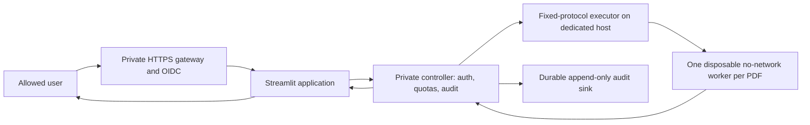

# Phase 8 technical plan: private live PDF analysis

Status: design only, 3 November 2026. Preserve the Phase 7 snapshot Site and existing forensic
implementation. No upload ingress, provider provisioning or billing is authorized by this plan.
The starting point is merged PR #7; reuse `app.py`, `preview_web`, `broker`, `executor`,
`container_runner`, `supervisor`, `release_gate` and existing container/browser tests.

## 1. Separate services and trust boundaries

Keep the snapshot Site independent; do not add an upload API to it. The gateway protects every
HTTP, WebSocket, upload, media, health and download route. The UI must never parse a PDF, hold a
Docker socket, launch subprocess analysis, accept a requested worker image or trust client identity
headers. The controller holds service credentials and authenticates the internal caller; only the
executor can reach its dedicated daemon. Executor access is host execution authority and needs its
own host/account boundary. Container isolation shares a kernel; it is not proof of resistance to
kernel exploits. Evaluate rootless runtime plus seccomp/AppArmor, or an approved stronger sandbox,
against the actual parser workload before choosing the host.

## 2. Provider qualification before provisioning

Sites is unsuitable for Python workers and stays the static presentation provider. Qualify an
existing authorized dedicated Linux VM/runtime that supports cgroups v2, rootless or restricted
container execution, private service routes, enforced egress controls, TLS, persistent audit storage
and remote CI identity. A generic HTTP-only/serverless container service is insufficient merely
because it runs Python: prove it can supply the separate isolated execution boundary. Managed
sandbox execution is an alternative only after no-network, limits, cleanup and credentials are tested.

Inventory available cloud identity and free quota first. Check current prices, idle/egress/storage
charges, account limits and lifecycle policies on the selected provider; do not infer free from a
trial credit. Reuse no Codespaces and require no laptop operations. If no safe free runtime exists,
finish infrastructure-as-code and qualification evidence before requesting the minimum browser-based
account authorization and explicit billing approval. No provider is qualified or purchased by this plan.

## 3. Identity and session implementation

Register an OIDC application with exact HTTPS redirect URI, issuer and audience. Use authorization
code flow with PKCE/state/nonce and provider-supported discovery/JWKS validation. Allow only explicit
verified identities; bind immutable issuer+subject to the account, not a client-provided email.
Separate owner/admin roles from permitted analysts and default-deny unknown tenants. Streamlit's
OIDC UI alone does not authorize raw upload/media routes: integrate the gateway/session boundary
with production OIDC and remove dependence on preview shared-password mode for production.

Use Secure, HttpOnly, appropriately SameSite cookies, bounded idle/absolute expiry, server-side
revocation, logout and token/key rotation. Retain Streamlit XSRF and authenticated WebSocket
handshakes. Strip inbound identity headers before constructing internal assertions; validate issuer,
audience, expiry and signature at the receiving service. Reject replay and cross-tenant report IDs.
Keep OAuth secrets, service keys and signing keys in the cloud secret manager; use workload identity
for CI/deployment where supported, no long-lived GitHub deploy key or worker credential.

## 4. Admission and analysis protocol

Initially single-tenant, explicit allowlist and one running worker per dedicated executor. Preserve
current fixed-protocol RPC; reject requests attempting to override command, image, environment,
mounts, networking or runtime flags. Pin approved worker by immutable digest with current full-image
scan and installed-Python audit. Never silently fall back to in-process or development subprocess parsing.

Apply size/deadline limits at gateway before buffering, then at UI/controller/worker. Decide the
production PDF upload cap (proposed initial 10 MiB, subject to representative load validation) and
configure all tiers consistently; the current supervisor 60 MiB input/82 MiB transport limits are
implementation ceilings, not a safe public policy. Validate magic/content structure in the isolated
worker, never trust filename/MIME. Reject encrypted/unsupported/malformed/resource-exhausting input
with structured reasons. Enforce page count, rendered pixel budget and output/evidence limits;
bounded decoding is required even for a small compressed input.

Existing worker policy baseline: UID 65532, network none, read-only root, capabilities dropped,
no-new-privileges, 1 CPU, 1 GiB memory with equal swap limit, 32 PIDs, 30 CPU seconds, 64 MiB
noexec/nosuid tmpfs, no host mounts, inherited proxies/credentials removed. Default supervisor wall
limit is 60 seconds and output cap 5 MiB. Verify actual cgroup enforcement on the chosen runtime,
not just command flags; add tmpfs nodev where supported. Account for kernel, cache, UI/controller
memory and concurrency headroom before selecting capacity. Rootless compatibility is not yet proved.

Do not add an unbounded queue. Keep existing one-active/backlog policy initially; reject excess
work with 429/Retry-After. Current broker quotas are in-process (10 requests/60 seconds by default,
1,000 tracked principals); replace with atomic durable/shared counters before replicas/restarts can
reset admission. Enforce per-user/IP and global burst, byte, concurrency and daily compute quotas.
A client cannot choose or rotate its principal. Test fair recovery after timeouts and controller outage.

## 5. Reports, storage and audit

Keep raw PDF processing memory/ephemeral only by default; no persistent upload bucket without an
approved retention policy. Stream bounded input to a disposable worker, validate bounded output
schema and render evidence as safe PNG/text. Treat report content/metadata as untrusted. Apply
no-store/private response headers, attachment filenames, CSP and per-request authorization to JSON,
PDF and evidence endpoints; use short-lived scoped identifiers if object storage is introduced.
Avoid report bytes or sensitive filenames in logs. Close temporary handles and remove worker/tmp
state on success, exception, timeout, cancellation, host restart and partial-write failure.

Bind a random job ID to owner, worker digest, input SHA-256, verdict/report digest, timestamps,
execution outcome and audit receipt. Extend the existing hash chain with durable append-only
storage, restricted writer identity, external anchoring, retention and recovery procedures. A local
hash chain alone cannot prove a privileged attacker did not rewrite all history. Decide explicit
retention/deletion and regional data policy before real documents. If audit append fails, fail closed
on admission/result release under a documented retry/idempotency policy. Use idempotency keys so
retries do not duplicate jobs or billable work. Download authorization must not rely on guessing hashes.

## 6. Delivery increments and concrete acceptance evidence

| Increment | Deliverable | Required acceptance evidence |
| --- | --- | --- |
| A — qualification | Provider decision, threat model, infrastructure plan, cost cap | Authorized identity, private routes, cgroups/runtime capabilities demonstrated; zero paid provisioning without approval |
| B — identity | Production OIDC/gateway integration and secret bindings | Actual remote login, denied unknown user, expiry/logout/replay, raw-media and WebSocket denial; no secret artifacts |
| C — isolated runtime | Dedicated executor and pinned worker | Non-root/no-network/read-only checks, cgroup CPU/memory/PID limits, credential removal, deadline kill and orphan cleanup on the actual host |
| D — private staging | UI/controller/executor wiring; allowlisted synthetic uploads only | Genuine/tampered/shadow/visual/unsigned/unsupported/oversized/error flows; actual images and exact JSON/PDF downloads through real HTTPS |
| E — resilience | Shared quotas, durable audit, cleanup/alerts | Parallel/burst tests, quota restart behavior, audit sink outage, service restart, storage full, timeout/cancellation and cross-user denial |
| F — controlled pilot | Reviewed attestation, operations and narrow user allowlist | Fresh exact-image scans, signed provenance, all mandatory controls true with artifact hashes, hosted browser evidence and rollback drill |

Add independent integration tests for identity spoofing, stale/expired sessions, cross-owner report
reads, content-type spoofing, truncated PDFs, decompress/render bombs, encoded filenames, direct
asset/media access, oversized chunked requests, concurrent exhaustion and queue fairness. Never
use real private documents in screenshots or public CI artifacts. Preserve all existing benchmarks
and forensic regressions; no detector tuning is part of deployment work.

## 7. CI/CD and release operations

Build each final image once, scan the same immutable artifact, generate SBOM/provenance, audit
installed distributions and run Docker/browser regressions before registry push. Use minimal-scoped
OIDC deployment identity, protected staging approvals, least-privilege registry permissions and
short evidence retention without tokens or uploaded PDFs. No scanner skips or suppression to clear
a gate. Run synthetic canaries on actual staged HTTPS URL; retain job/image/config identifiers,
anonymous denial, signed-in screenshots and exact download hashes. A service bearer probe must
remain labeled separately from interactive OIDC login.

Keep ingress closed until `release_gate` evidence passes; expand its attestation to bind all
service image digests/config version, current scans and operator-reviewed provider controls.
The existing validator consumes trusted evidence and cannot independently prove hosting security.
Add freshness policy and explicit tenant/audit/operations gates rather than trusting stale booleans.
Set alerts for denied/rate-limited requests, worker crashes, queue saturation, audit errors and disk
pressure, with redacted logs. Run patch/rebuild cadence and incident response drills.

Rollback: disable submissions/ingress, terminate or drain jobs within deadline, restore last clean
UI/controller/worker digests and compatible config/secret versions, verify audit continuity and
synthetic/auth canaries, then reopen only the approved allowlist. Never restore a known-vulnerable
image just for availability. Rehearse rollback and teardown of all provisioned resources before pilot.

## Remaining external requirements

An approved runtime/account identity and cost decision; private network/TLS endpoint; OIDC client
registration and production allowlist; restricted executor host/runtime; registry and CI workload
identity; shared quota store; durable audit/anchoring and approved retention; cloud secret manager;
monitoring/incident ownership. None is supplied by the private static Site. Their absence blocks
live upload deployment, not use of the existing trusted synthetic snapshots.
