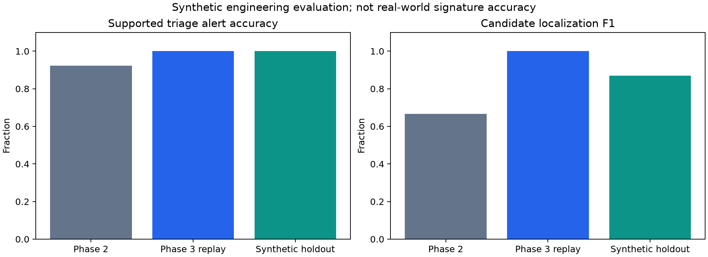

# Results — preserved forensic evaluation and cloud integration

## Codex recovery verification — 2026-11-02 UTC

No detector or benchmark-score tuning was performed. All four Codespaces commits through `2a89352`
were integrated from the published branch onto merged main `1afd853`. Fresh evidence is in
`evaluation/cloud-recovery/`; the recovered Codespaces scan files remain explicitly historical.

The final worker `sha256:976add9a3c886c519c2333f248d300eb27bd0961ea0f14201038055502dc8437`
was built in Codex Cloud with available OS updates and freshly scanned using pinned Trivy 0.76.1:
**2 CRITICAL, 36 HIGH, 116 MEDIUM, 105 LOW, 8 UNKNOWN** OS package findings. The scan's image ID
matches the tested image. No findings were suppressed; OS release admission is blocked.
The audit of packages actually installed in this worker found no known Python vulnerabilities.

Regression and enabled Docker controls: **84 passed, 12 explicit browser cases skipped**, with one
existing Starlette TestClient deprecation warning. Thirteen new demo checks cover all five actual
report classifications, digest/path rejection, PDF readability and no analysis-backend invocation.
The Docker checks also verify memory/PID/CPU configuration, tmpfs bounds, zero effective capabilities,
no-new-privileges and cleanup after a real worker failure. Real Chromium tests are separate; their
JUnit and screenshot artifacts distinguish cloud-process and container-hosted scope.
The Codex demo browser scenario passed in 14.63 seconds: five selections, ten actual report downloads,
decoded evidence images, no file inputs and five reviewed screenshots. Its viewer ran as a cloud
process; the full container browser scenario is assigned to Actions. A separate real demo-container
probe validated all bundles and absence of parser/backend modules. Cloud VFS disk exhaustion and
slow-start cleanup races were not counted as passes; the harness and cache usage were corrected.

The five synthetic demo examples produce the same verdicts listed in DEMO_GUIDE.md. They are
curated integration examples, not independent statistical evaluation or improved accuracy claims.
The viewer serves automatically generated snapshots and has no upload/URL/path interface.
No external URL, TLS route or hosted release is claimed by these tests.

## Historical Phase 3 results

Measured in Codex Cloud on 2026-11-02 (Asia/Calcutta).

## Direct replay of unchanged Phase 2 inputs

The labels and supported/all-case populations are unchanged. The 150-input replay is a regression
population already inspected during development, not a holdout. Broad classification now uses
the explicitly named `refined_classification`; the legacy image-presence field is retained.

| Metric | Phase 2 | Phase 3 replay |
| --- | ---: | ---: |
| Supported alert accuracy | 92.31% | 100.00% |
| All-case alert accuracy | 86.67% | 93.33% |
| Broad classification accuracy | 80.00% | 93.33% |
| Localization precision | 57.14% | 100.00% |
| Localization recall | 80.00% | 100.00% |
| Localization F1 | 66.67% | 100.00% |

The ten logo alerts and thirty false proposals from Phase 2 are eliminated on that same corpus;
the ten faint regions are recovered, and all ten controlled copied-signature cases still alert.
Ten single unauthorized-reuse cases remain visually ambiguous and produce no alert. Ten encrypted
PDFs remain unsupported. Unsupported cases were not relabeled or removed.

## Expanded split evaluation

360 inputs (345 valid synthetic PDFs plus 15 deliberately malformed PDF inputs), three splits
of 120 inputs, 24 families, and five variants per family. Template IDs and PDF hashes are disjoint
across splits. Within-split visual/unauthorized-intent ambiguity is deliberately retained.
Source PDFs/layout IDs differ across splits; generator families and attack concepts are shared.
This is a separate synthetic holdout, not an independent external dataset or field-accuracy estimate.

| Split | Supported N | Accuracy | Precision | Recall | F1 | FPR | FNR | All-case accuracy |
| --- | ---: | ---: | ---: | ---: | ---: | ---: | ---: | ---: |
| development | 105 | 100.00% | 100.00% | 100.00% | 100.00% | 0.00% | 0.00% | 95.83% |
| regression | 105 | 100.00% | 100.00% | 100.00% | 100.00% | 0.00% | 0.00% | 95.83% |
| holdout | 105 | 100.00% | 100.00% | 100.00% | 100.00% | 0.00% | 0.00% | 95.83% |

| Split | Localization TP/FP/FN | Precision | Recall | F1 | Broad class accuracy | Unsupported | Inconclusive |
| --- | --- | ---: | ---: | ---: | ---: | ---: | ---: |
| development | 50/15/0 | 76.92% | 100.00% | 86.96% | 83.33% | 12.50% | 66.67% |
| regression | 50/15/0 | 76.92% | 100.00% | 86.96% | 83.33% | 12.50% | 66.67% |
| holdout | 50/15/0 | 76.92% | 100.00% | 86.96% | 83.33% | 12.50% | 66.67% |

The holdout has 15 false proposals: five stamps, five scanned printed headers, and five extra
text-like regions on low-resolution scans. These remain counted as false proposals. Supported
alert false positives/negatives are zero in this synthetic holdout, with 30 TP and 75 TN. On all
120 inputs, five ambiguous reuse cases count as FN; ten malformed/encrypted negative-intent cases
error explicitly and are coded no-alert, not successful negative analyses. All-case recall is
85.71%; all-case F1 is 92.31%.
No unexpected supported-case exceptions occurred. Identity/authorization decisions explicitly abstain.

Full binary and broad-class confusion matrices and per-class precision/recall/F1 are in the split
summary JSON. Per-case outcomes, errors, ROI boxes, timings and classifications are in JSON and CSV.

## Freeze and security-upgrade chronology

The four detector source files were sealed before holdout results were opened; no detector
thresholds or rules were changed after seeing holdout results. The initial holdout ran with
Pillow 12.3.0. Dependency scanning then required Pillow 13.0.0 and pip upgrades. Initial holdout
outcomes are preserved separately, and final results are post-upgrade revalidation of those same
sealed PDF bytes. Revalidation is not another untouched holdout. Corpus ZIP and seal permit exact
input reproduction even if encoding libraries change. No external dataset was acquired.

## Timing and memory

| Split | Total analysis seconds | Median seconds | P95 seconds | Process high-water RSS MiB |
| --- | ---: | ---: | ---: | ---: |
| development | 10.745 | 0.0346 | 0.2582 | 146.61 |
| regression | 10.983 | 0.0377 | 0.2731 | 146.64 |
| holdout | 10.336 | 0.0370 | 0.2562 | 146.76 |

Timings exclude PDF generation and worker/container cold start. RSS is cumulative process high-water
RSS including native libraries, not isolated per-input peaks. `worker-controls.json` separately
records a disposable worker's measured analysis time and process peak RSS. Values depend on hardware.



## Cloud reproduction

```sh
python -m pip install -c requirements-cloud.txt -e '.[dev]'
python -m zipfile -e evaluation/phase3/corpus.zip phase3-output
python -m benchmarks.phase3 --output phase3-output --split holdout
pytest -q
```

For a newly generated corpus, choose a new output directory and run `--seal` before any `--split`.
Do not run `--create-templates` during reproduction: it creates new randomized signing/encryption
templates and defines a new corpus version. Public synthetic templates contain no private keys.
Runtime versions are stored in `evaluation/phase3/environment.json`. This evaluation is not a
certificate of safety, comprehensive attack coverage, or evidence of human handwriting identity.

## Phase 4 integration evidence (no benchmark retuning)

The Phase 3 detector fingerprint still matches its pre-holdout seal. No scoring population, threshold
or benchmark result was changed for Phase 4. This phase measures integration rather than accuracy.

A real remote Chromium run passed 11 end-to-end checks: anonymous/invalid login denial; signed,
byte-tampered, shadow-revealed, visual-only and unsigned uploads; evidence images; JSON/PDF downloads;
unsupported input; oversized upload rejection; logout; concurrent/quota handling; audit chain; and
broker-outage fail-closed behavior. Eleven screenshots and report artifacts were captured.

Codex used a non-root UI process due to its VFS disk limit, plus a containerized controller and
network-isolated disposable workers. The CI browser job uses all three containerized tiers. Its final
observed result is recorded in PROJECT_STATUS.md/the task report. The tested cloud loopback URL is not
a live user-accessible preview, and external OIDC/TLS/private forwarding remain unverified.

The first integration attempts found real routing and Unix-socket group-permission defects; these
were fixed before the successful run. Successful reports include verified digest/audit receipts,
worker isolation controls and a signed/current evidence pair for the shadow case. PDF downloads were
reopened and checked; no PDF report is offered when the analysis fails. Raw evidence is retained in
`evaluation/phase4/` and GitHub Actions artifacts. The OS scan is a separate unresolved release gate.

Final implementation verification: 70 non-browser tests and 11 remote gateway browser tests passed.
GitHub Actions run 41413174237 passed the full all-container UI/controller/executor/worker flow,
including direct anonymous/post-logout download denial, screenshots, downloads and OS scan collection.
Cloud tests run 41413174218 passed both Python versions and the isolated-worker/static/dependency job.
OS release admission remained blocked despite successful functional CI. The private live URL is absent.
